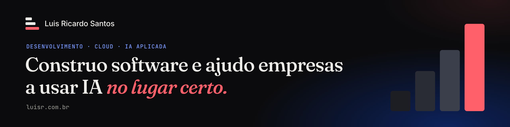

Entrei em tecnologia sem querer. Me matriculei no técnico achando que era Eletrônica e descobri no primeiro dia que a vaga era de Informática. Fiquei.

Em 2021 um hackathon pediu praticamente o meu TCC: chat, WebSocket, Node e React. A gente ganhou, e o prêmio era um estágio na [Tech for Humans](https://github.com/tech4humans-brasil). Hoje sou Gerente de Governança de TI e IA lá, com um time de 8 pessoas. No caminho escrevi muito código fullstack, fundei a área de DevOps e virei DPO.

A pergunta que mais me ocupa agora é onde a IA acelera o time e onde ela não deve entrar.

### No que eu tô mexendo

- **Mestrado em IA na UNIFEI.** Tutores com LLM: a IA está ensinando ou só entregando a resposta?
- **[Régua de autonomia](https://luisr.com.br/ia).** A ferramenta da minha palestra no HackTown 2026. Seis perguntas sobre uma tarefa dizem quanta autonomia a IA pode ter nela.
- **[Big Rick](https://obigrick.substack.com).** Newsletter de IA aplicada à engenharia, explicada pra todo mundo.

### Projetos

- **[Streamline](https://github.com/tech4humans-brasil/streamline)** · automação de processos que começou como EduFlow e virou a plataforma oficial da Tech for Humans. Mais de 50 processos automatizados. Open source.
- **[EduFlow](https://github.com/luisricar-do/edu-flow)** · sistema low-code para gestão de TCCs, testado com usuários e publicado no IEEE IISA 2025.
- **[Maiêutica](https://github.com/luisricar-do/maieutica)** · sistema multiagente socrático para ensinar lógica de programação em Portugol.
- **[luisr.com.br](https://github.com/luisricar-do/me)** · meu site. Página rolável, desktop com janelas, app no celular e um terminal, tudo lendo o mesmo conteúdo.
- **[Vôlei Cidadão](https://voleicidadao.com.br)** · site do projeto social que oferece vôlei gratuito a jovens em São Bento do Sapucaí.

### Publicações

- [EduFlow: sistema low-code configurável para gestão de trabalhos de conclusão de curso](https://ieeexplore.ieee.org/document/11311235/) · IEEE IISA 2025
- [LLM-Based Conversational Bots for Support and Question Answering in Higher Education: A Systematic Literature Review](https://ieeexplore.ieee.org/document/11705513/) · IEEE IISA 2026

### Stack

       

### Fala comigo

[luisr.com.br](https://luisr.com.br) · [eu@luisr.com.br](mailto:eu@luisr.com.br) · [LinkedIn](https://linkedin.com/in/luisricar-do) · [Big Rick](https://obigrick.substack.com)
